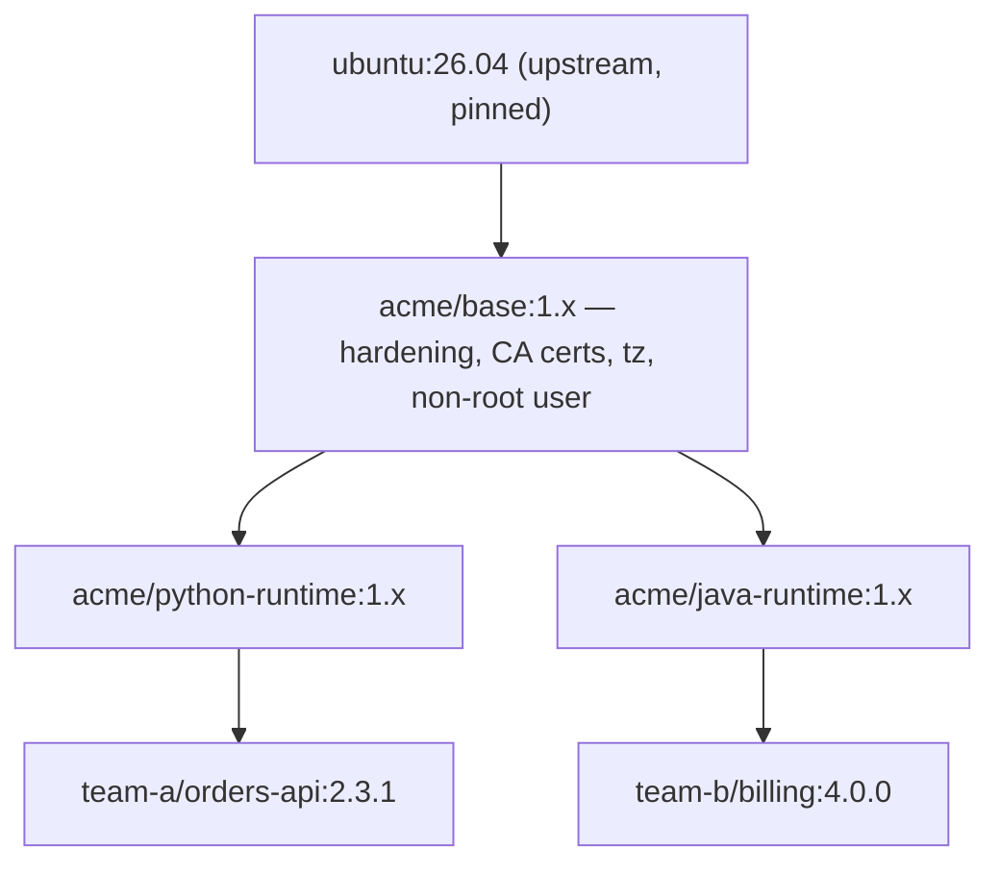

# 
 Project 01 — Internal Base-Image Factory & Image Promotion SOP
## $\textcolor{red}{\text{NOTE: USE UBUNTU 26.04 LTS VIRTUAL MACHINES FOR ALL THE LABS}}$

| | |
|---|---|
| **Module** | 3 — Docker I |
| **Level** | L2 — Engineer |
| **Role you play** | Platform Engineer owning the organisation's container base images |
| **Scope** | `Dockerfile.md`, `Docker-commands.md`, `Docker-push.md`, `Docker-commit.md` |

---
## 1. Business problem

Every team writes `FROM ubuntu:latest` and reinstalls the same packages, sets a different
timezone, runs everything as root, and ships images 1.2 GB in size. There is no way to answer
*"which images contain the vulnerable library?"* because no two images are built the same way.

The Platform team (you) must deliver an **internal base-image factory**: a small set of golden
base images that application teams build `FROM`, plus the **promotion SOP** that moves an image
from `dev` → `staging` → `prod` without rebuilding it.

## 2. Objectives

1. Build a hardened, non-root, labelled **organisation base image** on `ubuntu:26.04`.
2. Build a **language runtime image** on top of it.
3. Build a **sample application image** on top of that, proving the inheritance chain.
4. Implement **image promotion by re-tagging**, never by rebuilding.
5. Produce an inventory/trace procedure that answers "where is this base image used?".

## 3. Scope

**In scope:** Dockerfile instructions including `ARG`, `ENV`, `USER`, `WORKDIR`, `COPY`,
`RUN`, `ENTRYPOINT`, `CMD`, `LABEL`, `HEALTHCHECK`; `docker build --build-arg`, `history`,
`inspect`, `tag`, `push`, `pull`, `rmi`, `system prune`.

**Out of scope:** Compose/Swarm (Module 4), CI automation (Module 8), image signing.

---

## 4. Standard Operating Procedure (SOP)

> **SOP ID:** PLT-SOP-006 · **Title:** Base image build, versioning and promotion

### 4.1 Image hierarchy

