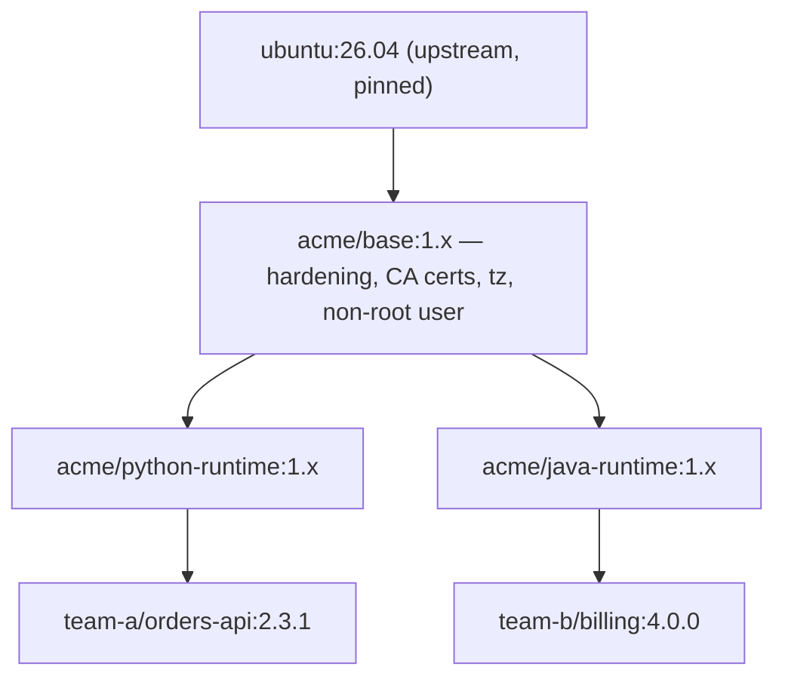

# <div align="center"> Project 01 — Internal Base-Image Factory & Image Promotion SOP
## $\textcolor{red}{\text{NOTE: USE UBUNTU 26.04 LTS VIRTUAL MACHINES FOR ALL THE LABS}}$

| | |
|---|---|
| **Module** | 3 — Docker I |
| **Level** | L2 — Engineer |
| **Role you play** | Platform Engineer owning the organisation's container base images |
| **Scope** | `Dockerfile.md`, `Docker-commands.md`, `Docker-push.md`, `Docker-commit.md` |

---
## 1. Business problem

Every team writes `FROM ubuntu:latest` and reinstalls the same packages, sets a different
timezone, runs everything as root, and ships images 1.2 GB in size. There is no way to answer
*"which images contain the vulnerable library?"* because no two images are built the same way.

The Platform team (you) must deliver an **internal base-image factory**: a small set of golden
base images that application teams build `FROM`, plus the **promotion SOP** that moves an image
from `dev` → `staging` → `prod` without rebuilding it.

## 2. Objectives

1. Build a hardened, non-root, labelled **organisation base image** on `ubuntu:26.04`.
2. Build a **language runtime image** on top of it.
3. Build a **sample application image** on top of that, proving the inheritance chain.
4. Implement **image promotion by re-tagging**, never by rebuilding.
5. Produce an inventory/trace procedure that answers "where is this base image used?".

## 3. Scope

**In scope:** Dockerfile instructions including `ARG`, `ENV`, `USER`, `WORKDIR`, `COPY`,
`RUN`, `ENTRYPOINT`, `CMD`, `LABEL`, `HEALTHCHECK`; `docker build --build-arg`, `history`,
`inspect`, `tag`, `push`, `pull`, `rmi`, `system prune`.

**Out of scope:** Compose/Swarm (Module 4), CI automation (Module 8), image signing.

---

## 4. Standard Operating Procedure (SOP)

> **SOP ID:** PLT-SOP-006 · **Title:** Base image build, versioning and promotion

### 4.1 Image hierarchy



### 4.2 Base image rules (non-negotiable)

| # | Rule | Reason |
|---|---|---|
| 1 | Pin the upstream tag (`ubuntu:26.04`), never `latest` | Reproducibility |
| 2 | Non-root `USER` by default | Blast-radius reduction |
| 3 | No shells/compilers that the runtime does not need | Attack surface |
| 4 | OCI labels on every image | Traceability/inventory |
| 5 | Single cleaned `RUN` layer for packages | Image size |
| 6 | `DEBIAN_FRONTEND=noninteractive` | Deterministic builds |
| 7 | No secrets, ever — they persist in layers | Security |
| 8 | Base images are rebuilt **monthly** for patches, bumping the minor version | CVE hygiene |

### 4.3 Promotion flow — **build once, promote by tag**

| Stage | Tag | Gate |
|---|---|---|
| Build | `acme/base:1.0.0-rc1` | Build succeeds, size budget met |
| Dev | `acme/base:dev` | Smoke test passes |
| Staging | `acme/base:staging` | Consumer images rebuild successfully |
| Prod | `acme/base:1.0.0` + `acme/base:prod` | Platform lead approval |

> The **same image digest** carries all the way through. If you rebuild between stages you have
> tested a different artefact than the one you shipped.

### 4.4 Change/rollback

* Rollback = repoint `acme/base:prod` to the previous version tag and notify consumers.
* Breaking changes (OS major, user/UID change, removed package) require a **major** version bump
  and a 30-day consumer migration window.

---

## 5. Hands-on implementation

### Step 1 — The organisation base image

```bash
mkdir -p ~/image-factory/base && cd ~/image-factory/base
```

```bash
cat > Dockerfile <<'EOF'
FROM ubuntu:26.04

ARG BUILD_DATE
ARG BASE_VERSION=1.0.0

LABEL org.opencontainers.image.title="acme-base" \
      org.opencontainers.image.version="${BASE_VERSION}" \
      org.opencontainers.image.created="${BUILD_DATE}" \
      org.opencontainers.image.vendor="ACME Platform Engineering" \
      org.opencontainers.image.base.name="ubuntu:26.04" \
      org.opencontainers.image.source="https://github.com/<you>/image-factory"

ENV DEBIAN_FRONTEND=noninteractive \
    TZ=Asia/Kolkata \
    LANG=C.UTF-8 \
    APP_HOME=/opt/app

# One cleaned layer: CA certs, timezone, minimal tooling
RUN apt-get update && \
    apt-get install -y --no-install-recommends \
        ca-certificates tzdata curl && \
    ln -snf /usr/share/zoneinfo/$TZ /etc/localtime && \
    echo $TZ > /etc/timezone && \
    apt-get purge -y --auto-remove && \
    apt-get clean && \
    rm -rf /var/lib/apt/lists/* /tmp/* /var/tmp/*

# Fixed UID/GID so volume permissions are predictable across hosts
RUN groupadd -g 10001 appgroup && \
    useradd  -u 10001 -g appgroup -m -s /usr/sbin/nologin appuser && \
    mkdir -p ${APP_HOME} && \
    chown -R appuser:appgroup ${APP_HOME}

WORKDIR ${APP_HOME}
USER appuser

CMD ["/bin/bash"]
EOF
```

```bash
docker build \
  --build-arg BUILD_DATE="$(date -u +%Y-%m-%dT%H:%M:%SZ)" \
  --build-arg BASE_VERSION=1.0.0 \
  -t acme/base:1.0.0-rc1 .

docker images acme/base
docker history acme/base:1.0.0-rc1
docker inspect acme/base:1.0.0-rc1 | jq '.[0].Config | {User, Env, Labels}'
```

**Verify the hardening claims:**

```bash
docker run --rm acme/base:1.0.0-rc1 id           # uid=10001 appuser, NOT root
docker run --rm acme/base:1.0.0-rc1 date         # timezone applied
docker run --rm acme/base:1.0.0-rc1 \
  sh -c 'curl -sI https://www.google.com | head -1'   # CA certs work
docker run --rm acme/base:1.0.0-rc1 \
  sh -c 'touch /etc/test 2>&1 || echo "write to /etc correctly denied"'
```

### Step 2 — Runtime image on top of the base

```bash
mkdir -p ~/image-factory/python-runtime && cd ~/image-factory/python-runtime
```

```bash


